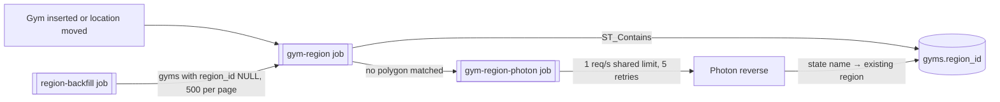

# Location names for gyms

Status: built on branch `phase-6-location-names-slice` (PR #35, stacked on #33). Linked from [DESIGN.md](./DESIGN.md) and the [README roadmap](./README.md#roadmap).

## Goal

The gym view (including gyms with no address yet), My requests and the admin approval list all show **"Region, Country"** for every gym instantly, with no geocoding at read time. A region is a state, province or island (e.g. "Bali, Indonesia", "California, United States").

**Regions only, no cities (decided by Joey 2026-11-07).** Cities aren't needed for now. A flat regions table is far smaller and simpler than a country → region → county → city hierarchy, and it's easy to extend later. The first build of this PR had the full hierarchy; it was cut back before merge.

## Schema

**New table `regions`** (migration `0009_location_regions`):

| Column | Type | Notes |
|---|---|---|
| `id` | bigserial PK | Stable across re-seeds (upsert by `source_ref`) |
| `name` | text, not null | As the source names it |
| `country_code` | text, not null | ISO 3166-1 alpha-2 |
| `geom` | `geometry(MultiPolygon, 4326)`, not null | GiST index |
| `source_ref` | text, unique, not null | `cgaz:ADM1:<shapeID>`, `fixture:...` |

**`gyms` gets two columns:**
- `region_id`: nullable FK → `regions.id` (`ON DELETE SET NULL`).
- `postcode`: nullable free text.

The region name is read by join, never copied onto `gyms`. The country name comes from `gyms.country_code`, which already drives price currency. It's set from the region at insert, kept in step by the fill job, and set by Photon when no region matches. So a gym outside every polygon still shows its country.

The word "admin" is kept out of these names on purpose (it clashes with the admin role).

## Boundary data

**Source:** geoBoundaries **CGAZ ADM1**, one global gap-filled file of first-level divisions (states, provinces, islands).
- Full world: **3,205 regions in 207 country codes**, **141 MB** in Postgres with indexes. The seed takes about 25 s (measured 2026-11-07).
- **License:** CC BY 4.0, and **attribution is required**: "geoBoundaries" (or `www.geoboundaries.org`) shown prominently, e.g. in the credits next to the OpenStreetMap attribution. That's a visible change, so it waits for Joey's OK.

**What the real file taught us:**
- **Country keys.** Countries are keyed by ISO3 in `shapeGroup`.
- **Disputed areas** (Aksai Chin, Gaza Strip, West Bank, Spratly Is, …) use numeric codes `111`–`129`. They have no ISO code and are skipped (19 keys), so gyms there get the Photon fallback.
- **Territories** filed under a parent get their own country code from a short explicit list (`TERRITORY_OVERRIDES`), so their prices use the right currency:
  - Hong Kong and Macau (under China);
  - Puerto Rico, Guam, American Samoa, the Northern Mariana Islands and the US Virgin Islands (under the USA);
  - Åland (under Finland).
- **Territories missing entirely** (Réunion, French Polynesia, Aruba, …) have no polygon. Photon still sets `country_code` there.
- **Mixed text encodings.** The `.dbf` claims Windows-1252, and `shp2pgsql` lets that override `-W UTF-8`. Most names are UTF-8, a few really are Windows-1252 ("Päijät-Häme"). The seed reads raw bytes (`-W LATIN1`) and decodes each name (`decodeDbfText`).
- **Dirty names.** Some are blank (skipped) or have stray whitespace (trimmed). A few have characters already lost at the source ("Hà N?i" for Hà Nội), which can't be repaired.
- **Country names** in CGAZ are US State Department style ("Korea, South"), so the API shows the English name for the ISO code instead (`Intl.DisplayNames`).
- **Outlines are heavily simplified.** Shanghai Municipality has 21 vertices. Some city-centre and coastal points fall outside every polygon. Spot check of 20 places: 15 got the right region, and these missed:
  - central Shanghai;
  - Hong Kong Central and Kowloon;
  - San Juan (Puerto Rico).

  Misses go to the Photon fallback. See open question 1.

**Seed script** (`npm run seed:regions --workspace apps/server`), separate from migrations:
- `--fixture` loads `apps/server/scripts/fixtures/regions.geojson`: four small rectangles plus one disputed code. Tests (and later CI) use this.
- No flag: downloads the CGAZ ADM1 zip (~100 MB, deleted afterwards), loads it with `shp2pgsql | psql`, then:
  - decodes names;
  - upserts with `ST_Multi(ST_CollectionExtract(ST_MakeValid(geom), 3))`;
  - applies territory codes.
- `--countries=THA,IDN` (ISO3) limits the load, for local dev.
- Needs `shp2pgsql`, `psql` and `unzip` on PATH (`shp2pgsql` ships with PostGIS), so no new npm dependency.

## Flow



1. **Fill on write.** After a gym row is committed, the writer enqueues `gym-region { gymId }` (dedup `jobId` `gym-region-<id>`; BullMQ rejects `:` in ids). The writers are:
   - `gym-upsert.ts` (Overpass refresh, sweeps), on insert and whenever the weekly refresh actually moves `location`;
   - `bot-review.ts`, after the transaction that inserts an approved `add_gym`.

   The job runs one indexed `ST_Contains` and sets `region_id` and `country_code`.
2. **Photon fallback.** Only when no polygon matched. `gym-region-photon` waits for a slot in a cache-backed limiter (about 1 request per second across all workers; Redis in scale mode), then calls `photon.komoot.io/reverse`.
   - It matches Photon's `state` to an existing region by case-insensitive name within that country; it never creates regions.
   - It sets `country_code` from Photon even when no region matches.
   - Outages throw, and the queue retries 5 times with exponential backoff (30 s first). When retries run out, `region_id` stays null and the gym is unaffected.
3. **Postcode.** Overpass `addr:postcode` → `RawGym.postcode` → `gyms.postcode` (COALESCE, never overwritten). The Google Maps scraper and website research have no structured postcode today, so they don't set one (never parsed from free text).
4. **Backfill.** `npm run backfill:regions --workspace apps/server` enqueues `region-backfill`. Each job enqueues `gym-region` for the next 500 gyms with no region (by id) and chains the next page. Re-run it after loading better boundaries.

`QueueInterface` gained opt-in `retries` / `retryDelayMs` (exponential backoff) for both pg-boss and BullMQ; other queues keep their current behavior.

## API fields

`place` is added to:
- `GET /v1/gyms/{id}`;
- each change in `GET /v1/me/requests` / `GET /v1/requests/{id}`, next to `gymId` (the request-level `gymName` comes from #33);
- each item in `GET /v1/admin/changes`.

```json
"place": { "region": "Bali", "country": "Indonesia", "countryCode": "ID", "postcode": "80571" }
```

- Every field is nullable.
- An `add_gym` change with no gym row yet resolves `place` from its proposed lat/lng with the same local lookup. That's a database query, not geocoding.
- The type lives in the server (`region-queries.ts`) and the app (`gym-panels.tsx`). `packages/shared` is still an empty placeholder stack-wide; wiring it up would add Zod to the app bundle, a separate decision.

**App** (layout unchanged):
- **Gym panel (native and web).** `AddressRow` shows "Region, Country" on a second line under the address, or alone under the same "Address" label when there is no address.
- **Admin queue.** The place sits after the coordinates, and stands in for a missing address on the "Current" line.
- **My requests** shows no location today, so it gets the API fields but no new UI.

## Tests

- **Unit** (`npm test`):
  - ISO3 → ISO2 (unique, two-letter);
  - `.dbf` text decoding (UTF-8, Windows-1252, Thai);
  - Photon parsing;
  - country names;
  - OSM postcode.
- **Integration** (`npm run test:integration --workspace apps/server`): needs PostGIS on `localhost:5433` and Redis on `6379`, or set `TEST_DATABASE_URL` to any `*_test` database.
  - Each run recreates `gymfinder_test`, migrates and loads the fixture, then runs the same 8 tests with `--mode demo` (pg-boss) and `--mode scale` (BullMQ). Vitest overwrites `process.env.MODE`, hence `--mode`.
  - The tests cover:
    - region + postcode;
    - Hong Kong → `HK`;
    - Photon fallback mapping;
    - Photon state with no matching region (country kept);
    - Photon down → gym kept, region null;
    - a refresh moving the gym to another region;
    - backfill;
    - My requests + admin list over HTTP with a real signed-up admin, including approving an `add_gym` end to end.
  - **Photon is stubbed** in these tests (fixed responses, a 503 for the "down" case); they never call the real service.
- The full-world CGAZ load and the 20-place spot check were run by hand into a throwaway database, not in automated tests.

## Open questions

1. **More accurate outlines.** CGAZ misses some city centres and coasts (Shanghai, Hong Kong, San Juan). Swapping the seed to OpenStreetMap state/province boundaries (ODbL, full detail, same source as our gyms) would fix it; jobs, API and tests stay the same. Then run `backfill:regions`.
2. **Photon name matching** is exact and case-insensitive, so Photon's "Shanghai" doesn't match CGAZ's "Shanghai Municipality". Those gyms get the country but no region. Strip common suffixes ("Province", "Municipality", "Special Administrative Region")?
3. **Display names** keep the source's style ("Chiang Mai Province", "LISBOA", "NORTH REGION", "Hong Kong SAR China"). Tidy them?
4. **geoBoundaries attribution** in the app: where and when? (Visible change, needs Joey's OK.)
5. **Territories with no polygon** (Réunion, French Polynesia, Aruba, …): fine with country only?
6. **CI.** There is no test workflow yet (README Phase 3 item); the fixture and `test:integration` are ready for one.
