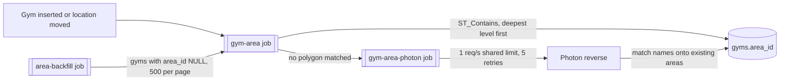

# Location names for gyms

Status: mechanism built and tested on branch `phase-6-location-names-slice`, stacked on #33. **Boundary source needs a decision** (open question 0): CGAZ is too coarse in city centres. Linked from [DESIGN.md](./DESIGN.md) and the [README roadmap](./README.md#roadmap).

## Goal

The gym view (including gyms with no address yet), My requests and the admin approval list all show **"City, Region, Country"** for every gym instantly. Nothing is geocoded at read time: names come from our own Postgres.

Before this, the admin list called Photon live for every row, and `gyms.country_code` came from a synchronous Photon call inside the insert path. Both are gone.

## Schema

**New table `areas`**: one row per boundary polygon (migration `0009_location_areas`).

| Column | Type | Notes |
|---|---|---|
| `id` | bigserial PK | Stable across re-seeds (upsert by `source_ref`) |
| `name` | text, not null | As the source names it |
| `level` | text, not null | `country` / `region` / `county` / `city` (check constraint) |
| `parent_id` | bigint, FK → `areas.id`, nullable | Null for countries, and for orphans with no containing polygon |
| `country_code` | text, not null | ISO 3166-1 alpha-2 |
| `geom` | `geometry(MultiPolygon, 4326)`, not null | GiST index |
| `source_ref` | text, unique, not null | `cgaz:ADM1:<shapeID>`, `gbOpen:ADM3:<shapeID>`, `fixture:...` |

**`gyms` gets two columns:**
- `area_id`: nullable FK → `areas.id` (`ON DELETE SET NULL`), the most specific area that contains the gym.
- `postcode`: nullable free text.

City, region and county text is **not** copied onto `gyms`. Reads walk `parent_id` up from `area_id` in one recursive query.

`gyms.country_code` stays, because it drives the price currency. It is set at insert from the polygon lookup (so the currency is right before the job runs), then kept in step by the fill job. Where no polygon exists, the Photon fallback sets it.

The word "admin" is kept out of these names on purpose (it clashes with the admin role).

## Boundary data

| Level | Source | Coverage |
|---|---|---|
| `country` | geoBoundaries **CGAZ ADM0** | 199 ISO countries + promoted territories |
| `region` (state / province / island) | geoBoundaries **CGAZ ADM1** | World (3,224 polygons) |
| `county` | geoBoundaries **CGAZ ADM2** | World where the country has ADM2 |
| `city` | geoBoundaries **gbOpen ADM3**, per country | 81 countries publish ADM3; 65 pass the license filter (2026-11-07 listing) |

**License.** geoBoundaries is CC BY 4.0, and **attribution is required**. In an app that means "geoBoundaries" (or `www.geoboundaries.org`) shown prominently, e.g. in the credits next to the OpenStreetMap attribution. Adding it to the UI is a visible change, so it waits for Joey's OK (open question 3).

gbOpen licenses vary per country. The seed loads one only if `boundaryLicense` is ODbL, CC BY (any version, including IGO), CC0 or Public Domain. It logs and skips everything else:
- share-alike: CC BY-SA 2.0 / 4.0;
- national licenses: Etalab (France), swisstopo, DL-DE-BY, OGL v3, KOGL;
- "Other - Direct Permission".

**What the real files taught us** (checked against the downloads, 2026-11-07):
- **Country keys.** CGAZ keys countries by ISO3 in `shapeGroup`. ADM0 has no `shapeID` (one row per country, so `source_ref` uses the ISO3); ADM1/ADM2 do.
- **Disputed areas** use numeric codes (`111`–`129`: Aksai Chin, Gaza Strip, West Bank, Spratly Is, …). They have no ISO code and are skipped, so gyms there get the Photon fallback.
- **Territories folded into a parent.** Hong Kong and Macau are ADM1 regions of China; Puerto Rico, Guam, American Samoa, the Northern Mariana Islands and the US Virgin Islands sit under the USA; Åland sits under Finland. A short explicit list (`TERRITORY_OVERRIDES`) promotes them to country level with their own code, so a Hong Kong gym gets `HK` (and HKD), not `CN`.
- **Territories missing entirely**, e.g. Réunion, French Polynesia, Aruba, Curaçao, Bermuda and the Cayman Islands. The Photon fallback still sets `country_code` there, so currency works, but there is no area to point at.
- **Mixed text encodings.** The `.dbf` header claims Windows-1252, and `shp2pgsql` lets that override `-W UTF-8`. Most names are actually UTF-8, but some really are Windows-1252 ("Päijät-Häme"). The seed reads raw bytes (`-W LATIN1`) and decodes each name: UTF-8 if valid, otherwise Windows-1252 (`decodeDbfText`).
- **Unnamed polygons.** Some ADM2 polygons have no name; they are skipped, so gyms there match the region.
- **Country names** in CGAZ are US State Department style ("Korea, South", "Burma"). The API shows the English name for the ISO code instead (`Intl.DisplayNames`).
- **No ADM3 for big backpacker countries.** Indonesia, Thailand, the USA and Vietnam have none, so gyms there get "County, Region, Country" at best (open question 1).

**Seed script** (`npm run seed:areas --workspace apps/server`), separate from migrations:
- `--fixture` loads `apps/server/scripts/fixtures/areas.geojson`: small hand-made rectangles covering a city, a county with no city, a promoted territory and a disputed code. Tests (and later CI) use this.
- No flag: downloads CGAZ ADM0/1/2 (about 350 MB of zips, deleted afterwards) and loads each with `shp2pgsql | psql`. It then fetches the allowed gbOpen ADM3 GeoJSON (simplified geometry). After that it:
  - upserts into `areas` with `ST_Multi(ST_CollectionExtract(ST_MakeValid(geom), 3))`;
  - promotes territories;
  - links parents by geometry, one parent level at a time, nearest first;
  - inherits `country_code` down the tree.
- `--countries=THA,IDN` (ISO3) limits the load, for local dev.
- Needs `shp2pgsql`, `psql` and `unzip` on PATH (`shp2pgsql` ships with PostGIS), so no new npm dependency.

## Flow



1. **Fill on write.** After a gym row is committed, the writer enqueues `gym-area { gymId }` (dedup `jobId` `gym-area-<id>`; BullMQ rejects `:` in ids). The writers are:
   - `gym-upsert.ts` (Overpass refresh, sweeps), on insert and whenever the weekly refresh actually moves `location`;
   - `bot-review.ts`, after the transaction that inserts an approved `add_gym`.

   The job looks up the deepest area one level at a time (city, county, region, country), stopping at the first match, so huge country outlines are rarely tested. It sets `area_id` and `country_code`.
2. **Photon fallback.** Only when no polygon matched. `gym-area-photon` waits for a slot in a cache-backed limiter (about 1 request per second across all workers; Redis in scale mode), then calls `photon.komoot.io/reverse`.
   - It maps Photon's `countrycode`, `state`, `county` and `city`/`district` onto **existing** areas by case-insensitive name within that country, preferring children of what already matched. It never creates areas.
   - It sets `country_code` from Photon even if no area maps.
   - Outages throw, and the queue retries 5 times with exponential backoff (30 s first). When retries run out, `area_id` stays null and the gym is unaffected.
3. **Postcode.** Overpass `addr:postcode` → `RawGym.postcode` → `gyms.postcode` (COALESCE, never overwritten). The Google Maps scraper and website research have no structured postcode today, so they don't set one (never parsed from free text).
4. **Backfill.** `npm run backfill:areas --workspace apps/server` enqueues `area-backfill`. Each job enqueues `gym-area` for the next 500 gyms with no area (by id) and chains the next page. Re-run it after loading more boundaries.

`QueueInterface` gained opt-in `retries` / `retryDelayMs` (exponential backoff) for both pg-boss and BullMQ; other queues keep their current behavior.

## API fields

`place` is added to:
- `GET /v1/gyms/{id}`;
- each change in `GET /v1/me/requests` / `GET /v1/requests/{id}`, together with `gymId` and `gymName`;
- each item in `GET /v1/admin/changes`, where it replaces the old live-Photon `locationLabel`.

```json
"place": { "city": "Ubud", "region": "Bali", "county": "Gianyar", "country": "Indonesia", "countryCode": "ID", "postcode": "80571" }
```

- Every field is nullable; a gym not yet filled returns all-null names.
- An `add_gym` change with no gym row yet resolves `place` from the proposal's lat/lng with the same local polygon lookup. That's a database query, not geocoding.
- The type lives in the server (`area-queries.ts`) and the app (`gym-panels.tsx`). `packages/shared` is still an empty placeholder stack-wide; wiring it up would add Zod to the app bundle, a separate decision.

**App** (layout unchanged):
- **Gym panel (native and web).** `AddressRow` shows "City, Region, Country" on a second line under the address, or alone under the same "Address" label when there is no address.
- **Admin queue.** The place sits where the Photon label was, and stands in for a missing address on the "Current" line.
- **My requests** shows no location today, so it gets the API fields but no new UI.

## Tests

- **Unit** (`npm test`):
  - license allow-list;
  - ISO3 → ISO2 (unique, two-letter);
  - `.dbf` text decoding (UTF-8, Windows-1252, Thai);
  - Photon parsing;
  - country names;
  - OSM postcode.
- **Integration** (`npm run test:integration --workspace apps/server`): needs PostGIS on `localhost:5433` and Redis on `6379`, or set `TEST_DATABASE_URL` to any `*_test` database.
  - Each run recreates `gymfinder_test`, migrates and loads the fixture, then runs the same 8 tests with `--mode demo` (pg-boss) and `--mode scale` (BullMQ). Vitest overwrites `process.env.MODE`, hence `--mode`.
  - The tests cover:
    - city match + postcode;
    - county-only;
    - Hong Kong → `HK`;
    - Photon fallback mapping;
    - Photon down → gym kept, `area_id` null;
    - a refresh moving the gym;
    - backfill;
    - My requests + admin list over HTTP with a real signed-up admin, including approving an `add_gym` end to end.
  - **Photon is stubbed** in these tests (fixed responses, a 503 for the "down" case); they never call the real service.
- The full CGAZ + gbOpen load was run by hand for IDN, CHN, PRT, FRA, THA, USA and FIN into a throwaway database. It is not part of the automated tests (too large).

## Open questions

0. **Blocking: CGAZ is too simplified for gym-scale lookups.** A real-data spot check (2026-11-07, seven countries loaded) found:

   | Point | Result | Why |
   |---|---|---|
   | Central Shanghai | no region | "Shanghai Municipality" has **21 vertices** and stops at lng 121.41 |
   | Hong Kong Central | China, not HK | the Hong Kong polygon leaves out Hong Kong Island (starts at lat 22.33) |
   | Central Lisbon | no county | "Lisboa" county has 7 vertices |
   | San Juan, Puerto Rico | no match | point on the coast, outside the simplified outline |

   Inland points (Ubud, Bangkok, Chiang Mai, Helsinki, Paris, New York) were right. gbOpen Portugal ADM3 also has stray polygon parts (Arroios got Vila Real as its parent) and corrupted names ("Uni3O Das Freguesias De 6Vora…").

   The jobs, API and tests don't depend on the source, so switching only changes `seed:areas`. Options:
   - (a) OSM admin boundaries (ODbL, full detail, same source as our gyms; `admin_level` meaning varies per country);
   - (b) gbOpen per-country full-resolution ADM1/ADM2 instead of CGAZ (licenses vary; still not consistently detailed);
   - (c) keep CGAZ and accept nearby polygons within a tolerance (wrong near borders).

   **Recommendation: (a).**

1. **City coverage.** Polygons only give a city where gbOpen has ADM3 under an allowed license. ADM3 isn't "city" everywhere, and Indonesia, Thailand, the USA and Vietnam have none. Options:
   - (a) also run Photon when the deepest match isn't a city, and store a geometry-less city row;
   - (b) GeoNames populated places (CC BY 4.0), nearest within a few km;
   - (c) accept the gap.

   **Currently (c)**, as the brief maps Photon onto existing areas only.
2. **Photon name matching** is exact and case-insensitive, so "Bali" vs "Provinsi Bali" or "Chiang Mai Province" vs "Chiang Mai" can miss. Add normalisation?
3. **geoBoundaries attribution** in the app: where and when? (Visible change, needs Joey's OK.)
4. **More gbOpen licenses?** Etalab (France), OGL v3 (UK), DL-DE-BY and KOGL are attribution-only open licenses but are skipped for now.
5. **Territories with no polygon** (Réunion, French Polynesia, Aruba, …): add per-territory boundaries from another source?
6. **Display names** keep the source's style ("Chiang Mai Province", "LISBOA", "Hong Kong SAR China"). Tidy them?
7. **CI.** There is no test workflow yet (README Phase 3 item); the fixture and `test:integration` are ready for one.
